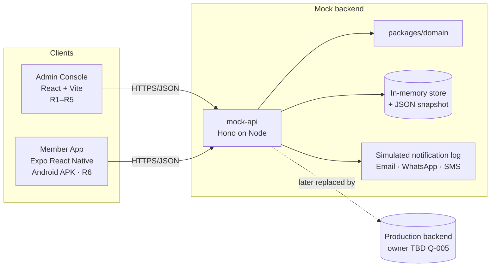

# 07 · System Architecture

> Phase 3 · Version 0.2 · 2026-10-24
> Accepted: D-008 (staff web stack), D-019/D-020 (separate Expo member app), D-021 (shared mock API), D-022 (Android APK). Proposed: D-024 (monorepo layout), D-025 (libraries).
> Scope: **two frontends + a mock API server**. The production backend is described only as a hand-off boundary. Its behaviour is NOT invented here (Q-005).

## 1. Architecture principles

1. **One mock backend, two clients.** The staff web app and the member mobile app both talk HTTP to `apps/mock-api`. A loan applied for on the phone appears in the accountant's Work Queue on the web. Neither app owns business data.
2. **The mock API behaves like a real API.** It uses the REST contracts in `11-api-contracts.md`, enforces roles/scopes and the loan state machine, and returns the documented error codes. Replacing it with the production backend should mean changing a base URL plus adapting contracts, not rewriting screens.
3. **One domain engine.** All money/eligibility logic is in `packages/domain` (pure TypeScript, unit-tested). The server uses it for every posting. The apps use it only for **live previews** (EMI calculator, eligibility hints). The server's answer always wins.
4. **Settings drive rules.** Every agreement number (10%, ₹200, ₹1,000, allocation order) and every UNKNOWN placeholder comes from the server's settings store, never from literals.
5. **Deterministic demos.** Seeded data, a server-side demo clock, a reset endpoint.

## 2. System context



## 3. Monorepo layout [P · D-024]

```
co-op/
  CLAUDE.md
  docs/
  apps/
    admin-console/              React 18 + TS + Vite + Tailwind + shadcn/ui
      src/app/              router, providers, StaffShell, route guards
      src/features/         members, loans, deposits, collections, reports, settings, workqueue, notifications, auth
      src/components/ui/    shadcn primitives + composites
    member-app/          Expo SDK 58 (React Native) + TS + Expo Router + StyleSheet/tokens (D-039)
      app/                  file-based routes: (auth)/, (tabs)/home, loans, deposits, payments, more/…
      src/features/         same feature names as web where applicable
      src/components/       RN components built on shared tokens
    mock-api/               Hono on Node
      src/routes/           one router per module (auth, members, loans, deposits, collections, reports, settings, notifications, support, demo)
      src/store/            in-memory db, snapshot persistence, seed loader
      src/middleware/       auth (persona token), scoping, latency, failure injection, error mapping
  packages/
    domain/                 pure business logic (BR-001…BR-021) + Vitest tests
    types/                  shared entity/DTO types + Zod schemas (validation on both client and server)
    api-client/             typed fetch client generated by hand from `11`. Used by both apps
    mock-data/              deterministic seed generator (`13`)
    design-tokens/          colours, type scale, spacing → Tailwind preset (web) + NativeWind preset (mobile)
  package.json ("workspaces": ["apps/*", "packages/*"]) / package-lock.json / tsconfig.base.json
  root scripts: `npm run demo` (mock-api + admin-console together), `npm test`, `npm run build:apk`
```

Dependency rule: `types` ← `domain` ← `mock-data` ← `mock-api`. `types` ← `api-client` ← apps. `design-tokens` ← apps. Apps never import from each other or from `mock-api`.

## 4. Logical modules

| Module | Responsibility | Staff web screens | Mobile screens | Domain functions |
|---|---|---|---|---|
| auth | Sessions, persona login, activation, OTP (mock) | AU-01, AU-03 | MA-01..03 | — |
| membership | Join pipeline, applicant accounts, eligibility, General No. allotment | ST-14..17 | MJ-01..05 | `checkMembershipEligibility` |
| members | Member master, pay profile, service history, documents, transfers, recovery mandates | ST-10..13 | MB-02 | `calculateLeftoverService`, `calculateNetSalary` |
| loans | Applications, workflow, sureties, schedules, top-up | ST-20..28 | MB-03..07 | `checkTenureEligibility`, `calculateEmi`, `generateSchedule`, `calculateShareDeduction`, `calculateAccruedInterest`, `calculateTopupSettlement` |
| deposits | FD, CRD, SRDS, Savings | ST-30..32 | MB-08..09 | `calculateFdMaturity` |
| collections | Demand sheets, recovery, receipts, insurance | ST-40..46 | MB-10 | `generateDemandSheet`, `allocateRecovery`, `calculateInsuranceDue` |
| reports | Registry, viewer, print layouts | ST-50..52 | — | report builders (server) |
| settings | Masters, rules, users, permissions, templates | ST-60..67 | MB-14 (view rates) | — |
| notifications | In-app + simulated outbound log | ST-03 | MB-12 | — |
| workqueue | Stage-based task aggregation | ST-02 | MB-07 (surety requests) | — |
| support | Member queries | — (P2 staff view) | MB-13 | — |
| demo | Reset, clock, failure rate, persona list, server URL | profile menu | hidden demo settings (MA-05) | — |

## 5. Client architecture

### Staff web
Page → TanStack Query hook → `api-client` → mock-api. Mutations invalidate queries, then show a toast. Forms use RHF + Zod schemas from `packages/types`. Route guards and `<Can action>` read the permission map returned by `GET /me`.

### Member mobile
Same pattern with Expo Router screens. Additions:
- **Server URL** is configurable at runtime (Q-010) in the hidden demo settings screen MA-05 (opened by long-pressing the login logo). Defaults to the build-time `EXPO_PUBLIC_API_URL`.
- Session token in `expo-secure-store`. Query cache persisted for quick relaunch. Mutations require connectivity.
- Offline / server unreachable → MA-04 state with Retry.
- Android hardware back follows the stack. Wizard back asks for confirmation if data was entered.
- Document "download" uses `expo-sharing` / the system viewer for the seeded sample PDFs.
- Build: `eas build -p android --profile preview` (APK) or a local Gradle build (Q-010/Q-011 settle the name and URL).

## 6. Mock API server [D-021]

| Concern | Behaviour |
|---|---|
| Runtime | Node LTS, Hono, port 4000. CORS enabled for the web dev origin |
| Store | In-memory collections per `08-data-model.md`. Snapshot written to `apps/mock-api/.data/snapshot.json` (debounced) and reloaded on restart. A schema version mismatch triggers a reseed |
| Seed | `packages/mock-data` with seed `20260705` |
| Auth | `POST /auth/persona` (demo) or `/auth/login` → opaque token mapping to {userId, role, memberId?, departmentId?}. `Authorization: Bearer` on every call |
| Authorisation | Middleware checks the permission map (`03`) and applies scoping (DDO → dept, Member → own). Returns `FORBIDDEN` |
| Workflow | `POST /loans/:id/transitions` validates (status, action, role) against `10` §1 → `INVALID_TRANSITION` |
| Latency | 200–600 ms random (env `MOCK_LATENCY=0` in tests) |
| Failure injection | `POST /__demo/failure-rate {rate}` makes that share of calls fail with `NETWORK`, to demonstrate error states |
| Clock | `POST /__demo/clock {today}`. Every domain call uses it |
| Reset | `POST /__demo/reset` restores the seed (staff profile menu + mobile demo settings) |
| Files | Seeded sample documents served from `/static/docs/*`. Uploads kept in memory as base64 (size cap 2 MB) |
| Messaging | Email/WhatsApp/SMS appended to the notification log with status `DELIVERED_SIMULATED` |
| OTP | Always `123456`. The response includes `demoOtp` so the app can show it in a toast |
| Exports | CSV generated server-side. PDF = web print of the ST-52 layout |
| Demo hosting | Laptop on the same Wi-Fi (APK pointed at `http://<laptop-ip>:4000`) or a small hosted instance. Q-010 |

## 7. Security model

### Prototype (actually built)
- Server-side role/scope enforcement (mirrors production expectations). Client guards are UX only.
- PII masking in list responses (mobile, Aadhaar, bank account). Caste returned only to permitted roles.
- Fictional seed data only. No real credentials. The demo token is not a security mechanism.
- Hosted demo (if chosen in Q-010): protect it with a shared demo passcode and reset it nightly [P].

### Target production (requirements to hand over, NOT designed here)
| Area | Requirement to confirm with the backend owner (Q-005) |
|---|---|
| Authentication | Method per Q-103. Lockout, session timeout, device binding for mobile |
| Authorisation | Server-side enforcement of the same role/stage/scope rules |
| Data protection | TLS. Encryption at rest. Restricted access to caste, Aadhaar, bank details. Retention (Q-408) |
| Mobile | Certificate pinning, secure storage, no PII in logs, Play Store distribution |
| Audit | Immutable log of financial postings and workflow transitions |
| Compliance | State co-operative society rules and India's DPDP Act 2023. Validate with the society |
| Hosting | Cloud hosting per the agreement (OUT of prototype) |

## 8. Integrations (all simulated)

| Integration | Source | Prototype | Production (to confirm) |
|---|---|---|---|
| Email / WhatsApp / SMS | F | Notification log on mock-api | Providers TBD. SMS needs DLT registration in India |
| Push notifications (mobile) | P | Not built. In-app notification list only | FCM (P2) |
| Bank disbursement | P | Manual reference entry | Likely manual (Q-315) |
| DDO salary recovery file | A (implied) | Simulated import | Format UNKNOWN (Q-007) |
| Report export | F | CSV + print-PDF | Server-side PDF/XLSX |

## 9. Failure handling

| Failure | Handling |
|---|---|
| API call fails / `NETWORK` | Web: error card + Retry. Mobile: inline error or MA-04 when the server is unreachable. Form input is preserved |
| `INVALID_TRANSITION` (someone else moved the loan) | Banner "This application has moved to *X* — reload" |
| `VALIDATION_ERROR` | Field errors mapped onto the form |
| `RULE_VIOLATION` | Shown with the rule explanation (e.g. BR-002 message) |
| `ALREADY_EXISTS` / `ALREADY_POSTED` | Idempotency message with a link to the existing record |
| Server restarted | Snapshot reload. Session tokens survive in the snapshot |
| Unhandled render error | Web: route error boundary → SYS-03. Mobile: error boundary screen with Restart |

## 10. Quality targets [P]

- Lists are server-paginated (page size 25 web, infinite scroll 20 on mobile).
- Seed size (≈ 600 members, ≈ 900 loans, 12 cycles) → list endpoints < 150 ms before injected latency.
- WCAG 2.2 AA on web (D-035). On mobile, accessibility labels, ≥ 48 dp touch targets, dynamic font scaling up to 130%.
- Staff web ≥ 1024 px fully supported. Mobile tested at 360×800 and 412×915 (Android).
