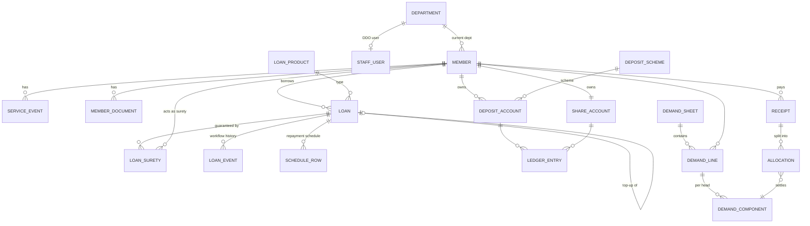

# 08 · Data Model

> Version 0.6 · 2026-10-30 · Production tables: see `docs/22` §5.1 (P1 auth) and §5.2 (P2 masters: versioned settings and loan products, REQ-130)
> Version 0.5 · 2026-10-24
> Entities for the mock store and TypeScript types. Fields tagged [A] are contractual, [P] proposed, `?` optional. All money values are stored as **integer paise** [P] to avoid floating-point errors, and displayed as ₹.
> 22 entities in MVP (26 with the P2 accounting entities).

## 1. ER overview

## 2. Entities

### Department [P]
`id, code, name, ddoName, ddoDesignation, ddoContact?, ddoUserId?, active`

### Member [A unless noted]
| Field | Type | Notes |
|---|---|---|
| id, memberNo [P] | string | memberNo e.g. `TGS-004512` |
| employeeId [P] | string | Needed for activation (Q-402) |
| name, fatherName | string | [A] |
| dob | date | [A] |
| caste | enum/string | [A]. Restricted (Q-406). Category list UNKNOWN |
| address | {line1, line2?, city, district, pincode} | [A] structure [P] |
| mobile | string | [A] |
| email?, gender?, photoUrl? | | [P] |
| aadhaarMasked?, pan? | string | [P] (Q-402) |
| designation | string | [A] |
| departmentId | ref | [A] current department |
| doj, dor | date | [A] |
| leftoverServiceMonths | **derived** | BR-001. Never stored |
| numberOfShares | int | [A] |
| anniversaryDate? | date | [A] |
| nominee | {name, relation, dob?} | [A] |
| bankAccount? | {holder, accountNoMasked, ifsc, bankName} | [P] disbursement |
| status | `ACTIVE \| RETIRED \| RESIGNED \| DECEASED` | [P] |
| portalActivated | bool | [P] |
| createdAt, updatedAt | datetime | |

### ServiceEvent [A "service history"; event types P]
`id, memberId, type: JOINED | TRANSFERRED | DESIGNATION_CHANGED | PROMOTED | RETIREMENT_DATE_CHANGED | RETIRED, fromValue?, toValue?, effectiveDate, orderRef?, remarks?, recordedBy, recordedAt`
Transfers also store `effectiveCycle` (YYYY-MM) = next demand cycle (BR-010).

### MemberDocument [A]
`id, memberId, docType (Q-403), fileName, mimeType, url, uploadedBy, uploadedAt`

### ShareAccount [A "Share Deposit"] (Q-304 to clarify share capital vs share deposit)
`id, memberId, numberOfShares, shareCapital (paise), shareDepositBalance (paise)` + LedgerEntry rows (`LOAN_DEDUCTION_CREDIT`, `ANNUAL_INTEREST`, …)

### LoanProduct [A types, F rates]
`id, code: ORDINARY | SALARY | EDUCATION | DEPOSIT_SHARE (final list Q-106), name, active, ratePercent, maxAmount?, maxTenureMonths?, minTenureMonths?, suretiesRequired, shareDepositPercent (Ordinary = 10 [A]; others Q-304), topupAllowed, penalRatePercent?, emiMethod: AMORTIZED | EQUAL_PRINCIPAL (Q-302), depositMarginPercent? (BR-015), effectiveFrom, history[]`

### Loan
| Field | Notes |
|---|---|
| id, applicationNo, loanNo? (assigned at disbursement) | |
| memberId, productId, departmentIdAtApplication | |
| appliedAmount, appliedTenureMonths, purpose? | [A] |
| educationDetails? {studentName, relation, institution, course} | [P] |
| status | see `10-workflows.md` §1 |
| sanctionedAmount?, sanctionedTenureMonths?, ratePercent?, emi? | set at assessment |
| deductions {shareDeposit, topupSettlementPrincipal, topupSettlementInterest, other[]} | BR-004, BR-007 |
| netDisbursable? | |
| disbursement? {mode, reference, date, byUserId} | |
| parentLoanId? | top-up source |
| ddoValidation? {mode: DIRECT \| MANUAL, ddoName, ref?, date, documentId?} | Q-102 |
| outstandingPrincipal, lastInterestChargedOn | after disbursement |
| closedOn?, closureReason? `REPAID \| TOPUP \| FORECLOSED` | |
| createdBy (member or staff), createdAt | |

### LoanSurety [A guarantor, F confirmation]
`id, loanId, suretyMemberId, status: PENDING | ACCEPTED | DECLINED | REPLACED, respondedAt?, declineReason?`

### LoanEvent (workflow audit)
`id, loanId, fromStatus, toStatus, action, actorUserId, actorRole, remarks?, at`

### ScheduleRow
`loanId, installmentNo, dueMonth (YYYY-MM), opening, interest, principal, emi, closing, paidStatus: UNPAID | PARTIAL | PAID`

### DepositScheme [A]
`id, code: FD | CRD | SRDS | SAVINGS, name, rateSlabs[] {fromMonths, toMonths, ratePercent}, monthlyContribution?, compounding? (Q-313), active`

### DepositAccount [A]
`id, accountNo, memberId, schemeId, openedOn, principal?, monthlyAmount?, tenureMonths?, ratePercent, maturityDate?, maturityValue?, balance, status: ACTIVE | MATURED | CLOSED, nominee`

### LedgerEntry (shared by deposit and share accounts)
`id, accountType, accountId, date, particulars, debit, credit, balanceAfter, sourceRef (receiptId/loanId)`

### DemandSheet [A]
`id, cycle (YYYY-MM), departmentId, status: GENERATED | SENT_TO_DDO | RECOVERY_POSTED, generatedBy, generatedAt, totals{}`

### DemandLine
`id, sheetId, memberId, designationSnapshot, totalDemand, recovered?, short?, excess?`

### DemandComponent
`id, lineId, head: RRF | INSURANCE | CRD | SRDS | PENAL | INTEREST | PRINCIPAL, loanId?, loanType?, amount, allocated, unpaid, priorityRank`
Note: SRDS rank is UNKNOWN (Q-309). It is kept in the enum but excluded from allocation until confirmed.

### Receipt
`id, receiptNo, memberId, date, source: SALARY_RECOVERY | CASH | BANK | ADJUSTMENT, amount, reference?, demandSheetId?, status: DRAFT | POSTED, postedBy, postedAt, unallocatedCredit`

### Allocation
`id, receiptId, componentId, amount`

### StaffUser [F roles]
`id, name, userId, mobile, email?, role: SUPER_ADMIN | ACCOUNTANT | APPROVER | DISBURSEMENT | DDO, departmentId? (DDO), status`

### Settings (single document) [F A]
`general{…}, insurance{nonLoaneeAmount: 20000 paise, loaneeAmount: 100000 paise, frequency (Q-306)}, rrf{amount? (Q-301)}, allocationOrder[] (A §3.6, locked), demand{cycleDay}, retirementAge (Q-314), shareValue (Q-304), shareDepositInterestRate (Q-305), notificationRules[], permissions{}`

### Notification / NotificationLog [F]
`id, recipient (userId|memberId), channel: IN_APP | EMAIL | WHATSAPP | SMS, templateKey, subject?, body, status: DELIVERED_SIMULATED | READ, link?, createdAt`

### SupportTicket [F Help/Support, P fields]
`id, memberId, subject, message, status: OPEN | ANSWERED | CLOSED, replies[], createdAt`

### P2 (accounting, Q-401)
`Account (chart of accounts)`, `Voucher`, `VoucherLine`, `FinancialPeriod`. Not modelled until scope is confirmed.

## 3. Enumerations to confirm
Caste categories (Q-406) · Nominee relations · Document types (Q-403) · Disbursement modes · Member statuses · Service event types (Q-404).

## 4. v0.3 additions from the paper forms (doc 16)

### Identifier change
`Member.memberNo` → **`Member.generalNo`** ("General No.", the society's identifier on every form. Exact meaning Q-501). Display label everywhere: "General No.".

### Member: new fields [PF F1]
`presentAddress`, `permanentAddress` (replaces the single `address`), `regularAppointmentDate`, `employmentType: REGULAR | APPROVED_PROBATIONER`, `probationServiceMonths?`, `nominee.address`, `payProfile` (below), `section?`.

### PayProfile (embedded, versioned) [PF F2 F3]
`scaleOfPay, substantivePay, officiatingPay?, officiatingPost?, totalServiceInOfficiatingPostMonths?, grossSalary, govtLoanDeductions, otherLoanDeductions, compulsoryDeductions[] {type: INSURANCE | GPF | INCOME_TAX | OTHER, amount}, certifiedBy?, certifiedAt?, source: APPLICATION | STAFF`

### ApplicantAccount [P, D-026]
`id, fullName, mobile (verified), createdAt, applicationId?, convertedMemberId?`

### MembershipApplication [PF F1]
`id, applicationNo, applicantAccountId, status (doc 10 §2), personal{fullName, fatherName, dob, presentAddress, permanentAddress, mobile}, employment{departmentId, designation, regularAppointmentDate, employmentType, probationServiceMonths?}, sharesProposed, nominee{name, relation, address}, eligibilityAnswers{}, documents[], declarations{byelawsAccepted, noOtherSociety}: SignatureRecord, recoveryMandateId, ddoCertification?: {items: {itemNo, ok, comment?}[], by, at}, infoRequests[] {by, role, fields[], message, at, resolvedAt?}, approvals: ApprovalSignature[], sharePayment?: {route: COUNTER | FIRST_DEMAND, receiptId?, cycle?}, allottedGeneralNo?, events[]`

### SignatureRecord [P, D-031]
`signerType: APPLICANT | MEMBER | SURETY, signerId, textKey, textVersion, textHash, otpVerifiedAt, deviceInfo, ip?`

### ApprovalSignature [PF, D-027]
`entityType: LOAN | FD | MEMBERSHIP, entityId, step: SECRETARY | PRESIDENT, userId, decision: SIGNED | REJECTED | SENT_BACK, remarks?, at`

### RecoveryMandate [PF F5 F6]
`id, memberId | applicationId, textVersion, scope: [BORROWER, SURETY], includesGratuityRecovery: true, memberSignature: SignatureRecord, ddoAgreement?: {ddoUserId, departmentId, at}, status: SIGNED | AGREED | PENDING_NEW_DDO | SUPERSEDED, history[]`

### Loan: new fields [PF F2 F3]
`applicationSnapshot { payProfile, netSalary, netSubstantivePay?, netPayEarnedToDate?, sharesHeld, paidUpShareCapital, additionalSharesProposed?, securityType: SURETY | DEPOSIT_PLEDGE | OTHER, securityDescription?, instalments (≤100) }`, `applicantSignature: SignatureRecord`, `ddoCertification?`, `officeUse { olBalance, slBalance, interestToDate, totalLoansBalance, olTakenOn?, slTakenOn?, suretyRecoveries }` (computed at assessment), `approvals: ApprovalSignature[]`.

### LoanSurety: new fields [PF F2 item 9–10]
`particularsSnapshot { generalNo, office, dob, designationOfficiating, substantivePay, officiatingPay, totalServiceInOfficiatingPost, sharesHeld, additionalSharesProposed?, dor, retiresDuringLoan: boolean }`, `existingGuarantees[] {borrowerName, generalNo, designation, department, loanNo, outstanding}`, `signature?: SignatureRecord`, `correctionRequest?`

### LoanProduct: workflow config [D-030]
`suretiesRequired, ddoCertificationRequired, maxInstalments (100 for Ordinary/Education), signOffSteps: [SECRETARY, PRESIDENT]`

### DepositAccount (FD): new fields [PF F4, D-028]
`fdrNo?, payoutFrequency: MONTHLY | QUARTERLY | HALF_YEARLY | ON_MATURITY, holders[] {memberId? | name, relationToPrimary?, fatherOrHusbandName, occupation, address, phone}, operationMode: SINGLE | EITHER_OR_SURVIVOR | ANY_ONE_OR_SURVIVOR, minor?: {name, dob, guardianName, guardianRelation, majorityDate}, requestStatus (doc 10 §3), paymentReceiptId?, approvals: ApprovalSignature[], applicantSignature: SignatureRecord, rulesTextVersion`

### Receipt: new fields [PF F4]
`mode: CASH | BANK_TRANSFER | ADJUSTMENT, denominations?: {500, 200, 100, 50, 20, 10: count}, purpose: DUES | SHARE_CAPITAL | FD_DEPOSIT, cashierUserId, sealStamp {name, at}`

### DemandSheet: new fields [PF F6]
`status adds CERTIFIED, certifiedBy, certifiedAt`. DemandComponent head adds `SHARE_CAPITAL`.

### Department: new fields
`kind: SECRETARY_DEPT | EXTERNAL_OFFICE`, `address?` (for out-of-Secretariat transfers, Q-512).

**Entity count:** 22 (v0.2) + ApplicantAccount, MembershipApplication, RecoveryMandate, ApprovalSignature = **26 MVP** (SignatureRecord, PayProfile and FD holders are embedded value objects).
## 5. v0.4 additions (Member sitemap, doc 17)

### PaymentReport [D-043]
`id, memberId, amount, paidOn, mode: BANK_TRANSFER | UPI | CHEQUE_DEPOSIT, reference, towards: DUES | SHARE_CAPITAL | FD_REQUEST, linkedEntityId?, screenshotDocId?, status: REPORTED | VERIFIED | REJECTED, verifiedBy?, verifiedAt?, receiptId?, rejectReason?, createdAt`

### ProfileChangeRequest [D-044]
`id, memberId, fields[] {field, oldValue, newValue}, reason, documentId?, route: OFFICE | DDO_THEN_OFFICE, status: PENDING | APPROVED | REJECTED, decidedBy?, decidedAt?, remarks?, createdAt`

### DepositAccount: new field [D-045]
`pledgedToLoanId?`. A pledged FD cannot be closed early.

**Entity count:** 26 + PaymentReport, ProfileChangeRequest = **28 MVP**.

## v0.5 as built (M3b members module, D-057)
- `ServiceEvent {id, memberId, type: JOINED|TRANSFERRED|DESIGNATION_CHANGED|RETIREMENT_DATE_CHANGED|PROFILE_UPDATED|RETIRED, date, summary, effectiveCycle?, byName?}`.
- `RecoveryMandate {id, memberId, departmentId, status: AGREED|PENDING_NEW_DDO|SUPERSEDED, signedOn, agreedOn?, agreedByName?}`: one current (non-superseded) mandate per member.
- `ProfileChangeRequest {id, memberId, fields[{field, oldValue, newValue}], reason, documentName?, route: OFFICE|DDO_THEN_OFFICE, status, createdAt, ddoCertified?, decidedByName?, decidedAt?, remarks?}`. `ProfileField` = name, fatherName, dob, designation, doj, dor, nominee.name, nominee.relation, payProfile.scaleOfPay, payProfile.grossSalary.
- `TransferEvent` gained `id, effectiveDate?, remarks?, recordedAt?, recordedByName?`. Seed version 7.
