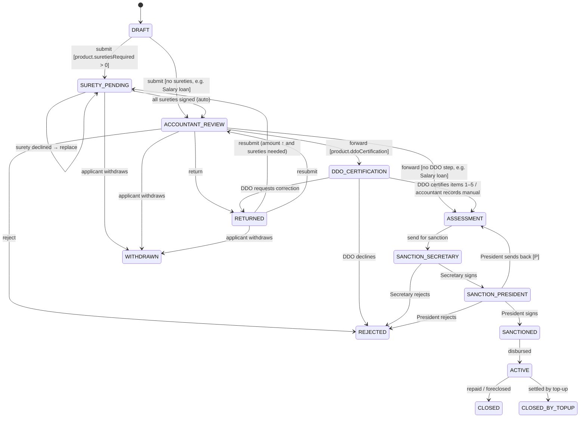
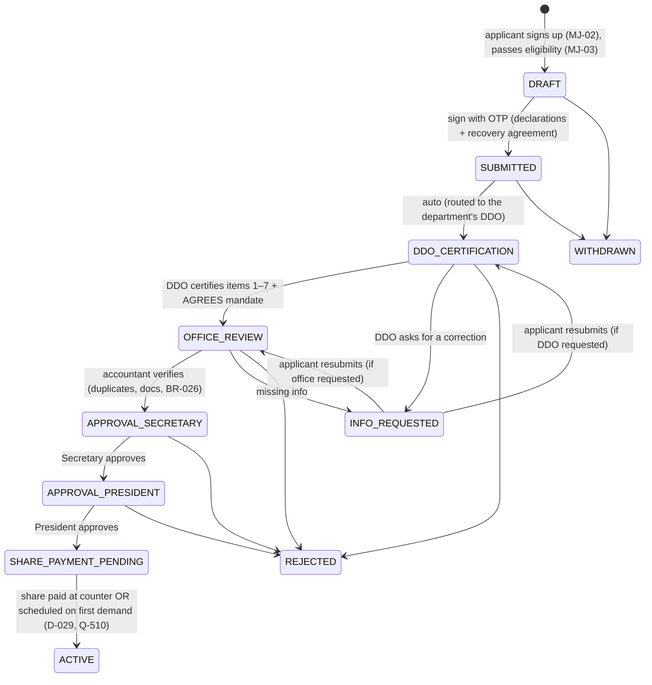
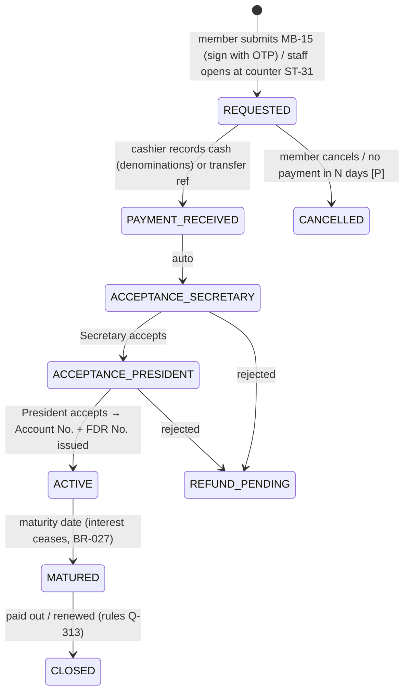
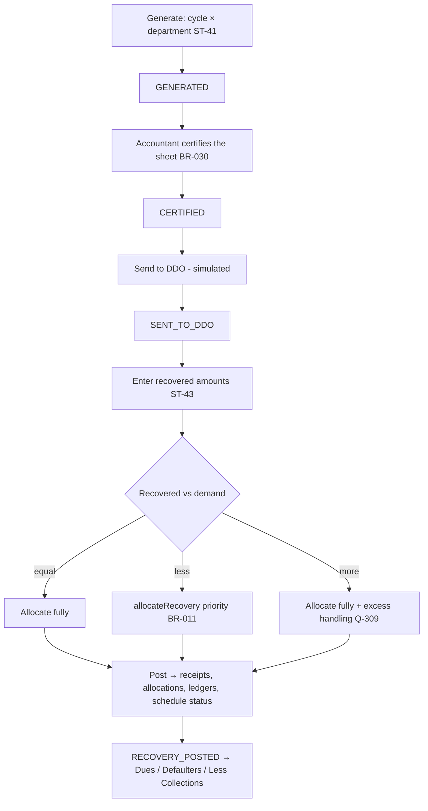

# 10 · Workflows & State Machines

> Version 0.3 · 2026-10-24
> Reconciles the flow diagrams (D-007) with the paper forms (doc 16): sequential Secretary → President sign-off (D-027), per-product stages (D-030), membership join pipeline (D-026), FD acceptance.
> All transitions are enforced by the API (`POST /…/transitions`). Each one writes an event {actor, role, action, remarks, at} and triggers notifications per ST-63.

## 1. Loan lifecycle

### Product workflow configuration (D-030, ST-64)
| Product | Sureties stage | DDO certification | Max instalments | Sign-off | Source |
|---|---|---|---|---|---|
| Ordinary | ✓ (count Q-104) | ✓ items 1–5 | 100 | Secretary → President | F2 |
| Education | ✓ | ✓ | 100 | Secretary → President | F2 |
| Salary | ✗ | ✗ | Q-502 | Secretary → President | F3 (confirm, Q-502) |
| Deposit / Share Capital | ✗ (security = pledged deposit) [P] | Q | Q | Secretary → President | No form seen |

### Transition table
| From | Action | To | Actor | Payload | Source |
|---|---|---|---|---|---|
| DRAFT | `submit` | SURETY_PENDING or ACCOUNTANT_REVIEW | Member (app) / R1 / R2 | complete application, applicant **Sign with OTP**, BR-002 + BR-022 pass | F p2, PF |
| SURETY_PENDING | `suretySign` / `suretyDecline` | auto ACCOUNTANT_REVIEW when all signed | Surety (app) | confirmed particulars + undertaking OTP / reason | F p2, PF F2 §12 |
| SURETY_PENDING | `replaceSurety` | SURETY_PENDING | Applicant / R2 | new surety | P |
| ACCOUNTANT_REVIEW | `forward` | DDO_CERTIFICATION or ASSESSMENT | R2 | checklist | F |
| ACCOUNTANT_REVIEW | `return` / `reject` | RETURNED / REJECTED | R2 | reason | P (Q-114) |
| DDO_CERTIFICATION | `ddoCertify` | ASSESSMENT | R5 (dept) | per-item confirmation of items 1–5 | F p5, PF F2 |
| DDO_CERTIFICATION | `ddoRecordManual` | ASSESSMENT | R2 | DDO name, ref, date, scanned certificate | F p3 (Q-102) |
| DDO_CERTIFICATION | `ddoReturn` / `ddoDecline` | RETURNED / REJECTED | R5 | reason | P |
| ASSESSMENT | `sendForSanction` | SANCTION_SECRETARY | R2 | office-use panel completed (computed) | F, PF F3 back |
| SANCTION_SECRETARY | `secretarySign` / `secretaryReject` | SANCTION_PRESIDENT / REJECTED | R3a | remarks / reason | PF, D-027 |
| SANCTION_PRESIDENT | `presidentSign` / `presidentReject` / `sendBack` | SANCTIONED / REJECTED / ASSESSMENT | R3b (≠ Secretary user) | remarks / reason | PF, D-027 |
| SANCTIONED | `disburse` | ACTIVE | R4 | mode, ref, date | F p6 |
| ACTIVE | `close` | CLOSED | system / R2 | — | P |
| ACTIVE | top-up disbursed | CLOSED_BY_TOPUP | system | — | A §3.3 |
| SURETY_PENDING, ACCOUNTANT_REVIEW, RETURNED | `withdraw` | WITHDRAWN | Applicant | reason | P |

Side effects on `disburse`: assign Loan No. → generate schedule (BR-006) → credit share deposit (BR-004) → close the parent loan for a top-up (BR-007) → notify member and sureties.

**Status chips [P]:** Draft grey · In process blue · Returned amber · Awaiting Secretary / Awaiting President purple · Sanctioned teal · Active green · Rejected red · Withdrawn/Closed neutral.

## 2. Membership: join pipeline (D-026)

| Applicant sees (MJ-05) | Internal state(s) |
|---|---|
| ① Application received ("You're in the queue") | SUBMITTED |
| ② Department verification | DDO_CERTIFICATION |
| ③ Society office review | OFFICE_REVIEW |
| ④ Approval | APPROVAL_SECRETARY, APPROVAL_PRESIDENT (shown as one stage with "1 of 2 signatures") |
| ⑤ Share payment | SHARE_PAYMENT_PENDING (instructions: pay at counter, or "will be deducted from <month> salary") |
| ⑥ Welcome, General No. 4xxx | ACTIVE → app switches to member mode |
| ⚠ Action needed | INFO_REQUESTED (what is needed, by whom, deep link to fix) |
| ✕ Not approved | REJECTED (reason, contact office) |

**On ACTIVE (side effects):** create the Member record from the application → allot the next General No. (Q-501) → create the ShareAccount (shares proposed) → activate the RecoveryMandate → the applicant account becomes a member account (same login) → welcome notification.

## 3. Fixed deposit: request → acceptance (D-027, D-028)

Interest starts from the deposit date (payment received) [ASSUMPTION, confirm in Q-313].

## 4. Demand & recovery cycle (BR-009…011, BR-030)

New members with "share by salary deduction" get a SHARE_CAPITAL line on their first sheet [P].

## 5. Counter receipt (ST-45)
Member → mode (Cash: denomination counter must total the amount (BR-029) / Bank transfer: reference) → heads (dues by priority, share capital, FD payment) → post → printable receipt.

## 6. Department transfer (BR-010, BR-028)
ST-13 → ServiceEvent(TRANSFERRED, effectiveCycle) → profile shows the new department immediately → demand uses the department effective for the cycle → the recovery mandate goes to `PENDING_NEW_DDO` and appears in the new DDO's queue to **agree** → transfer outside the Secretariat uses an external office from the department master (Q-512).

## 7. Surety sub-flow (F2 items 9–12)
At submit, one request per surety → surety opens MB-07 → sees the loan summary, their **auto-filled particulars** (pay, shares, retirement flag, existing guarantees) and the joint undertaking (clause 12) → confirms "My details are correct" → Sign with OTP, or Decline with a reason → when all have signed, the loan advances. A decline notifies the applicant, who replaces the surety.

## 8. Existing member activation
Staff-created or seeded member → MJ-01 "I'm a member" → MA-02 (General No./Employee ID + registered mobile → OTP → set password) → if no recovery mandate is on file, prompt to review and sign it [P] → MB-01.
## 9. Member-reported payment (D-043)
`REPORTED` (member, MB-18) → cashier ST-47 → `VERIFIED` (receipt created, BR-011 allocation, member notified) | `REJECTED` (reason, member notified). A report never changes balances until it is verified.

## 10. Profile change request (D-044)
Contact fields: saved immediately (mobile after OTP), audit entry. Certified fields: `PENDING` → (DDO certifies first if employment/pay, Q-121) → Accountant `APPROVED` (master updated, ServiceEvent if department/designation) | `REJECTED`.

## 11. Loan against FD (D-045)
MB-09 → MB-05 (Deposit loan, security = FD) → normal loan lifecycle (§1, product config) → on disbursement the FD is set `pledgedToLoanId` → released when the loan closes.
