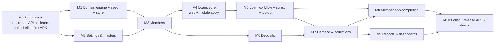

# 14 · Implementation Plan

> Phase 5 · Version 0.2 · 2026-10-24 · Applies to the **accepted MVP** (D-023): Admin Console 36 pages, Member App 19 screens, shared mock API.
> Gate: no milestone starts before D-000 "Plan approved" is Accepted in `decisions-log.md`.
> Milestones are **vertical slices**: each one delivers the API endpoints, the web screens and the mobile screens for one module, so cross-app journeys work as soon as the module is done.

## 1. Dependency graph

## 2. Milestones

| # | Milestone | Mock API | Staff web | Member mobile | Blocking Qs | Exit criteria |
|---|---|---|---|---|---|---|
| M0 | Foundation | Hono skeleton: `/health`, `/auth/persona`, `/me`, `/__demo/*`, error mapping, latency, auth middleware | Vite + Tailwind + shadcn, tokens, StaffShell, router, guards, AU-01, SYS-01..03 | Expo + Expo Router + NativeWind, tab shell, MA-01, MA-04, MA-05. **First Android APK** | Q-008, Q-010, Q-011 | Each persona logs into the correct app. APK on a real Android phone reaches the laptop server. Forbidden routes blocked server- and client-side |
| M1 | Domain engine + seed + store | Store, snapshot persistence, seed loader | — | — | Q-302, Q-303 (placeholders OK) | 11 domain functions with tests (incl. agreement examples). Seed integrity checks pass. 100% branch coverage on `packages/domain` |
| M2 | Settings & masters | settings, loan-products, deposit-schemes, departments, users, permissions, templates | ST-60..67 | MB-14 rates view | Q-108 | Changing a rate on the web changes the mobile EMI calculator result after refresh |
| M3 | Members & Joining | members, pay profile, transfers, documents, mandates, **membership pipeline**, signatures | ST-10..17 | MB-02 profile + agreements, **MJ-01..05 join flow** | Q-402, Q-403, Q-406 | J-09, J-11 pass |
| M4 | Loans core | loans list/get, eligibility, drafts, member search | ST-20, ST-21, ST-23 | MB-03, MB-04, **MB-05 apply wizard** | Q-104, Q-106, Q-115 | Application submitted on the phone appears in ST-20 on the web. BR-002 block shown for Ramaiah |
| M5 | Loan workflow | transitions (state machine), surety responses, top-up, sanction sheet, work queue, notifications | ST-02, ST-22, ST-24..28, sanction letter (ST-52) | MB-06 top-up, **MB-07 surety**, status timeline in MB-04 | Q-101, Q-102, Q-113, Q-114 | J-01 → J-08 pass **across both apps** (phone apply → phone surety → web stages → phone sees ACTIVE) |
| M6 | Deposits | deposits, preview, ledger, **FD requests + acceptance**, receipts with denominations | ST-30..33 | MB-08, MB-09, **MB-15** | Q-301, Q-313 | J-12 pass. FD visible on the phone |
| M7 | Demand & collections | demand preview/generate/send, recovery preview/post, receipts, statements | ST-40..46 | MB-10 | Q-306, Q-308, Q-309, Q-316 | J-10 pass. Mahesh's allocation waterfall identical on web and phone |
| M8 | Member app completion | activation/OTP, password reset, support tickets | — | MA-02, MA-03, MB-01 home, MB-11 calculators, MB-12, MB-13 | Q-105/116, Q-107 | J-14 pass. Activation flow works for a non-activated seeded member |
| M9 | Reports & dashboards | report registry + 8 builders, CSV export, dashboard aggregates | ST-01 (5 variants), ST-03, ST-50..52 | — | Q-310, Q-405 | J-13 pass. Report totals reconcile with ledgers |
| M10 | Polish & release | Hosted demo instance if Q-010 = hosted | States/a11y/responsive audit | Signed release APK, app icon/name, TalkBack pass | Q-011 | Test plan §5 checklist 100%. Demo script rehearsed on a device |

**Lean fallback (if time is cut):** M0 → M1 (loan functions only) → M2 (ST-64) → M3 → M4 → M5. Mobile: MA-01, MA-04, MA-05, MB-01..07, MB-11, MB-12.

## 3. Sequencing rules for Claude sessions
1. One milestone per branch. Do not start M(n+1) before M(n)'s exit criteria pass.
2. Inside a milestone, build in this order: `packages/types` → `packages/domain` (if needed) → mock-api routes + tests → `api-client` → web screens → mobile screens → states → E2E.
3. Before building any screen, re-read its spec in `06` and the rules it references in `09`.
4. When a spec gap is found, stop and add a question to `open-questions.md`. Do not improvise business logic.
5. At the end of each session, update the status table below and `CLAUDE.md` §2.

## 4. Status tracker

| Milestone | Status | Notes |
|---|---|---|
| M0 | ✅ Done 2026-10-24 (branch `m0-foundation`) | Real APK on a phone still to do (needs an Expo account). Console visual check by the user pending |
| M1 | Not started | |
| M2 | Not started | |
| M3 | Not started | |
| M4 | Not started | |
| M5 | Not started | |
| M6 | Not started | |
| M7 | Not started | |
| M8 | Not started | |
| M9 | Not started | |
| M10 | Not started | |

### v0.3 notes
- M3 also delivers **J-15 (join)** and **J-19 (DDO certify)** across both apps. Exit: an applicant joins on the phone → DDO, office, Secretary and President act on the web → the share payment is recorded → the phone switches to member mode with a General No.
- M4/M5 deliver the product-specific forms (F2, F3), the surety particulars and signing (J-18), the office-use panel and the **two-step sanction**. Exit: J-17 (salary loan) passes.
- M6 exit: J-16 (FD via app) passes, with the FDR visible on the phone.
- M7 adds demand **certification** (BR-030).
- M9 adds the 9 printable form twins (ST-52).
